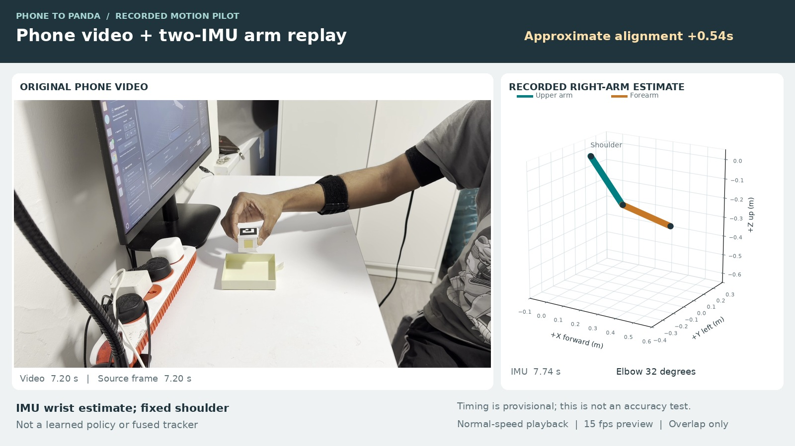
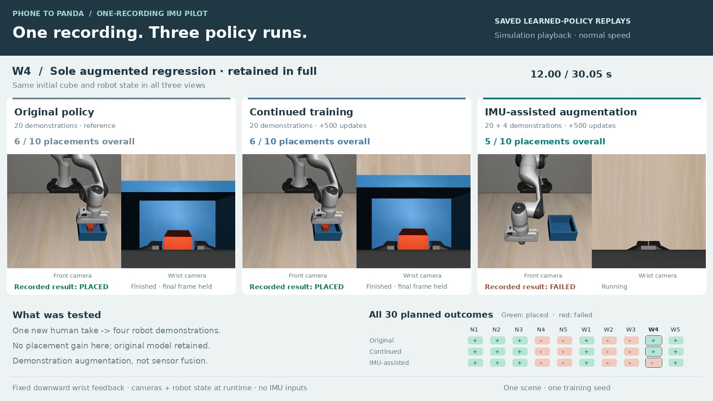

# Phone to Panda

This project uses five phone recordings of a person moving an object to train a
simulated Franka Panda arm to pick up a cube and place it in a box.

The original vision-trained model completed **43/60 placements** in the
[controlled simulator study](#vision-only-study-11-october-2026). A later,
smaller experiment adds one phone-and-IMU recording and tests whether it helps.

**[Code walkthrough](docs/code_walkthrough.md) · [Run the simulator](#run-it) · [IMU pilot report](docs/imu_pilot_20261015.md) · [Recording guide](arm_checker/guide/PhoneToPanda_Phone_IMU_Recording_Guide.pdf)**

## Watch the experiments

| Phone recording and arm estimate | Three-model comparison |
| --- | --- |
| [](#phone-and-imu-replay) | [](#three-model-comparison) |
| **[Play phone + IMU replay](#phone-and-imu-replay)** · 14.4 seconds. Real phone footage beside a fixed-shoulder arm estimate. Alignment is approximate, not a tracking-accuracy measurement. | **[Play the policy comparison](#three-model-comparison)** · 45.65 seconds. A shared success followed by the sole IMU-model regression, with every attempt shown in full. |

The IMU pilot scored **6/10 original, 6/10 continued training, and 5/10 with
IMU-assisted demonstrations**. It did not demonstrate an improvement. The
comparison shows saved learned-policy trials at normal simulation speed; shorter
attempts hold their final frame. All 30 outcomes remain visible. The examples are
N1 (the first planned narrow start) and W4 (the only augmented regression), not a
selection of only successful attempts.

### Phone and IMU replay

https://github.com/user-attachments/assets/fd77a2ce-bcf4-40fd-b95f-831d87905c92

### Three-model comparison

https://github.com/user-attachments/assets/358c801e-04f7-4bf5-8e96-ca9819406703

<details>
<summary>Watch the full phone recording from the IMU take</summary>

https://github.com/user-attachments/assets/f407df74-4ec6-40a4-8f8c-1756380ca6cf

</details>

[Original marker-based phone clip](data/raw/IMG_2096.MOV) ·
[Download the full phone clip from the IMU take](media/imu_pilot/phone_recording.mp4) ·
[Video edits and source mapping](media/imu_pilot/publication.json) ·
[Comparison provenance](media/imu_pilot/policy_comparison.json)

Public phone clips are silent and have personal metadata removed. The new
full-length clip also uses SDR tone mapping for browser playback; its frames and
timing are retained. The original five phone recordings remain the basis of the
main project. The IMU extension adds one paired human recording.

## Demo

https://github.com/user-attachments/assets/cd2a40a9-f291-4689-98fd-d2583f1f6e8b

**Interactive demo · silent · normal speed.** Choose a cube position and test the
saved model in the desktop MuJoCo viewer. The video shows the placement controls
and simulator side by side. Startup and window arrangement are omitted, and the
surrounding desktop is cropped out; the robot attempts remain one continuous
sequence. These interactive attempts are separate from the measured evaluation
below. [Download the MP4](media/demo.mp4) · [Video edit record](media/demo_info.json).

The method is **object-motion retargeting followed by imitation learning**.
Markers make the object's carry path measurable. That path is replayed by the
robot in a small custom LIBERO scene, and successful replays become the training
data for SmolVLA. The model learns movement and gripper commands; a separate
feedback controller keeps the wrist pointing down.

## Vision-only study: 11 October 2026

Using the same five recordings, a controlled study tested longer training and
extra robot demonstrations. The extra demonstrations used randomly chosen starts,
starts near earlier failures, or an expert controller recovering from a failed
grasp. Five saved models completed the same **60 new simulator starts each**,
after selection on separate development starts.

| Model | Narrow starts | Wide starts | Total placements |
| --- | ---: | ---: | ---: |
| Original, selected before final testing | 25/30 | 18/30 | **43/60** |
| Continued training, +2,000 updates | 24/30 | 20/30 | **44/60** |
| Uniform replay augmentation, +2,000 updates | 26/30 | 18/30 | **44/60** |
| Targeted replay augmentation, +2,000 updates | 20/30 | 18/30 | **38/60** |
| Uniform replay augmentation, +4,000 updates | 24/30 | 18/30 | **42/60** |

**The original remains the default.** It won the development tie under the rule
fixed before final testing; the adaptation comparisons are secondary. Uniform
augmentation fixed one final-test failure and introduced none, a one-case gain
that does not establish a reliable general improvement. Recovery training scored
13/20 in development and did not advance. All 17 original-model final failures
occurred before a successful lift, without recorded firm two-finger contact.


Read the [full study](docs/improvement_20261011.md), inspect the
[evidence and reproducible summaries](results/improvement_20261011/README.md), or
watch the [paired rollout for the one improved start](media/final_uniform_improved_seed6128.mp4).
These are results from one training seed and one custom simulation scene, not
official LIBERO benchmark scores or real-robot tests. The separate
[4 October experiment](docs/results.md) achieved 15/20 versus 14/20 on different starts.

## Experimental IMU extension: 15 October 2026

One new paired phone recording and two right-arm IMUs produced four successful
Panda demonstrations. The estimated wrist path supplies the carry motion; video
supplies manual event times, and a scripted controller handles grasp and release.
The learned policy still receives simulator images and robot state.

Both new models started from the same original checkpoint and received 500 extra
updates. The continued-training model used only the original 20 demonstrations;
the augmented model used those 20 plus the four IMU-assisted demonstrations.

| Model | Narrow starts | Wide starts | Total placements |
| --- | ---: | ---: | ---: |
| Original | 3/5 | 3/5 | **6/10** |
| Continued training, +500 updates | 3/5 | 3/5 | **6/10** |
| IMU-assisted augmentation, +500 updates | 3/5 | 2/5 | **5/10** |

The augmented model fixed no failed starts and lost one successful placement.
All failed trials stopped before a successful lift, without a recorded firm
two-finger grasp. The original remains the default. These ten matched simulator
starts are separate from the earlier 60-start study; their scores should not be
combined or compared as if the difficulty were identical.

Read the [method and limitations](docs/imu_pilot_20261015.md), inspect the
[complete comparison](results/imu_pilot_20261015/README.md), or use the
[saved replay page](results/imu_pilot_20261015/index.html) through the local server
described in the report. This is demonstration augmentation from one new human
recording, not a vision-only versus IMU-only versus sensor-fusion study.

**What I would try next.** I would inspect the failed pickups first, then collect
more varied paired recordings with secure mounting, measured arm lengths, clear
timing cues and repeated calibration checks. Better capture quality may make the
demonstrations more useful, but that has not been established here. Better sensors
alone would not guarantee better grasping. A follow-up should compare equal
training budgets and reserve separate recordings for evaluation.

## Run it

Open a terminal in this folder. The tested system is Ubuntu 24.04 with Python
3.12, an NVIDIA RTX 5060 with 8 GB of VRAM, and a working NVIDIA driver with EGL.
The setup creates a local `.venv`. Python needs venv support; the interactive
desktop viewer also needs Tkinter (`python3-tk` on Ubuntu) and a desktop session.
Installing dependencies and downloading the pretrained model need internet access.

```bash
bash setup.sh
bash run.sh doctor
```

To try the original saved model without retraining, download its release archive
(about 800 MB to download, 1.2 GB unpacked) and launch the interactive simulator:

```bash
python3 scripts/download_checkpoint.py --model original
bash demo.sh --checkpoint checkpoints/pilot_20261015/original
```

The same [model release](https://github.com/sushanthsujeerkumar/PhoneToPanda/releases/tag/imu-pilot-20261015)
also contains the two experimental models. Run one simulator at a time:

```bash
python3 scripts/download_checkpoint.py --model continuation
bash demo.sh --checkpoint checkpoints/pilot_20261015/continuation

python3 scripts/download_checkpoint.py --model augmented
bash demo.sh --checkpoint checkpoints/pilot_20261015/augmented
```

The downloader verifies the archive hash and keeps existing model folders intact.
The first model load also downloads its upstream tokenizer/configuration if they
are not already cached. These models are for the included simulation scene.

To rebuild the original dataset from the five supplied recordings and train a
new model instead:

```bash
.venv/bin/python scripts/build_dataset.py
bash train.sh
bash demo.sh --checkpoint runs/train/checkpoints/last/pretrained_model
bash evaluate.sh --checkpoint runs/train/checkpoints/last/pretrained_model --episodes 20 --seed 4000
```

The dataset script prepares the recordings, generates 20 physics replays and
exports the successful episodes for LeRobot. Training uses 5,000 updates with
batch size four. Settings are in [configs/main.yaml](configs/main.yaml).

Without `--checkpoint`, the demo and evaluation first look in `checkpoints/main`,
then in `runs/train/checkpoints/last/pretrained_model`. The commands above select
the newly trained model explicitly.

For the downloaded reference, run
`bash demo.sh --checkpoint checkpoints/pilot_20261015/original`.
In the placement window, choose a cube start and click **Run / Pause**. You can rotate and zoom in the MuJoCo window. Use
**Reset** for another attempt. Positions outside the marked training area are
harder and may fail. The viewer does not save a video.

Weights stay outside Git history and are distributed as release downloads.
The [checkpoint guide](checkpoints/README.md) records the three model identities,
licenses and download checks. Training from the supplied recordings is also
supported; fresh training may produce different weights and outcomes.

On **11 October**, 137 tests passed, including physics checks, and all 300 planned
final policy trials completed. The original phone recordings and checkpoint were
preserved. See the [study verification](results/improvement_20261011/final_verification.json)
for evidence checks and [development notes](docs/development_notes.md) for the
separate 4 October fresh-environment check. The 15 October pilot added 30 planned
policy trials; its [verification record](results/imu_pilot_20261015/verification.json)
records 197 passing tests and two optional physics-test skips.

The [publication checks](results/publication_20261015.json) then passed 224 project
tests, 111 arm-checker tests and 10 recording-timer checks, with the same two
optional physics-test skips. The [inline video copies](media/video_links.json)
were fetched without signing in and matched the repository MP4s byte for byte.

## What is in the project?

| Path | Contents |
| --- | --- |
| `data/raw/` | Five accepted phone recordings, with private metadata and audio removed |
| `data/calibration/camera.json` | Camera calibration used for tracking |
| `data/annotations/` | Visually labelled grasp and release times |
| `data/processed/` | Measured paths and tracking reports |
| `phone_to_panda/` | Tracking, simulation, dataset and policy code |
| `configs/main.yaml` | Original 20-demonstration experiment |
| `configs/expanded.yaml` | Additional 40-replay experiment |
| `configs/improvement_20261011/` | Controlled continuation, augmentation and recovery experiments using the same five recordings |
| `configs/imu_pilot_20261015/` | Frozen settings for the one-recording IMU experiment |
| `data/experimental/imu_20261015/` | Selected sensor session, event labels and estimated wrist trajectory |
| `results/` | Saved evaluation reports, action traces, replay videos and figures |
| `media/imu_pilot/` | Public phone footage, paired arm replay and three-model comparison |
| `arm_checker/` | Separate two-sensor arm viewer, calibration, recording and illustrated capture guide |

The five source recordings are `IMG_2092`, `IMG_2093`, `IMG_2095`, `IMG_2096` and
`IMG_2098`. Replaying them at several object starts adds robot demonstrations,
but the dataset still contains only five human recordings.

Read these in order to understand the project; the experiment reports can wait
until you are comfortable with the main pipeline:

- [Code walkthrough](docs/code_walkthrough.md): file map, data and action formats, and small changes to practise.
- [Method](docs/method.md): what comes from the videos and what the controllers do.
- [Recording and calibration](docs/recording.md): the physical setup and accepted clips.
- [Results](docs/results.md): training settings, tests and failure cases.
- [11 October controlled study](docs/improvement_20261011.md): matched training controls, recovery experiments and a reserved final comparison.
- [Development notes](docs/development_notes.md): dated changes and earlier attempts.

## Check an IMU setup


This is the right-arm branch of my existing harness: GPIO 8/9 connect to the
multiplexer, and both IMUs share channel 2. The forearm's AD0 jumper gives it a
different address. Everything uses 3.3 V and common ground. Follow printed pin
labels; these drawings show connections, not physical pin positions.
See the [hardware notes](arm_checker/hardware_setup.md#right-arm-wiring).

The separate [right-arm checker](arm_checker/README.md) shows a two-segment arm,
sensor health and calibration, and saves local recordings for replay. Try it
without hardware:

```bash
bash arm_checker/run.sh --demo
```

Open http://127.0.0.1:8765/. Demo input is labelled synthetic. For the existing
ESP32 rig, use `bash arm_checker/run.sh --port auto --protocol am` instead.
The [illustrated recording guide](arm_checker/guide/PhoneToPanda_Phone_IMU_Recording_Guide.pdf) covers
camera placement, sensor mounting and a proposed paired video/IMU pilot.

This viewer estimates motion relative to a fixed shoulder. Physical tracking
accuracy remains unmeasured. Accurate camera synchronization and vision/IMU
fusion remain future work.

## Built with

[LIBERO](https://github.com/Lifelong-Robot-Learning/LIBERO) supplies the simulation
framework, [LeRobot](https://github.com/huggingface/lerobot) handles the dataset and
training, and [SmolVLA](https://huggingface.co/lerobot/smolvla_base) is the pretrained
policy being fine-tuned. OpenCV tracks the printed markers; MuJoCo simulates
contacts between the robot, cube and box.

Project code uses the [MIT license](LICENSE). Bundled LIBERO assets retain their
[upstream license and provenance](assets/libero/PROVENANCE.md). Pretrained model
weights have their own license.
