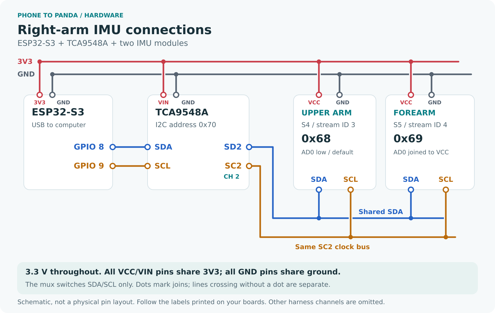
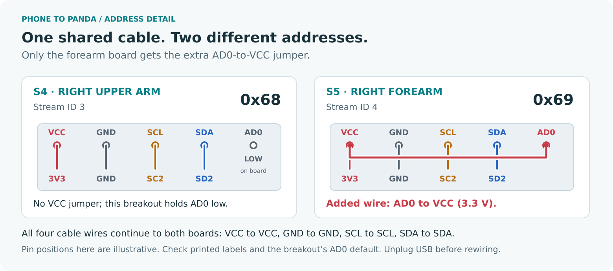

# Hardware setup and checks

This checker consumes orientation estimates; it does not flash firmware or
change wiring. Start with [the demo](README.md#quick-start-without-hardware),
then use the existing USB rig. Only one process should open its serial port.

## Right-arm wiring





The drawings follow the right-arm branch in the supplied Phase 1 build guide
(pages 3–5), checked against the existing ESP32-S3 firmware. GPIO 8 is SDA and
GPIO 9 is SCL on this rig. Both sensors share SD2/SC2, 3V3 and GND; only the
forearm has an AD0-to-VCC jumper. The upper-arm breakout already holds AD0 low.
The mux uses its existing default address, 0x70. These defaults depend on the
breakout boards; follow printed labels and unplug USB before changing wires.

## Existing rig and record identity

The existing ESP32-S3 firmware sends COBS-framed AM v1 packets with CRC32 at
921600 baud. Each data packet contains five fixed records:

| ID | Intended segment | Multiplexer channel | Sensor address |
|---|---|---:|---:|
| 0 | Chest | 0 | 0x68 |
| 1 | Left upper arm | 1 | 0x68 |
| 2 | Left forearm | 1 | 0x69 |
| 3 | Right upper arm | 2 | 0x68 |
| 4 | Right forearm | 2 | 0x69 |

The checker defaults to IDs 3 and 4. The mux address is 0x70, separate from the
sensor's WHO_AM_I register. The five boards previously reported WHO_AM_I 0x70
and use Mahony software fusion on MPU6500-compatible registers. That register
value does not establish chip authenticity or prove MPU6050 DMP support.

The original wiring guide labels these physical boards **S4** (right upper arm)
and **S5** (right forearm). Its numbering starts at one; stream IDs start at zero.
Both boards use mux channel 2. The checker displays only the two assigned sensor
cards and reports a missing card if either assigned ID is absent from the stream.

Keep all five records in the existing stream; no firmware change is needed to
view just the right arm. Before mounting, move one selected board at a time
and watch which sensor's orientation and gyro values respond. Confirm the
upper-arm and forearm assignments physically. Use an explicit serial path when
more than one plausible device is connected.

## Calibration and mounting

1. Keep the boards stationary for ten continuous seconds after startup so the
   existing firmware can estimate gyro bias. Movement restarts that sensor's
   capture. Wait for valid, fresh data from both selected sensors.
2. Place both boards flat, chip/+Z side up, with +X axes pointing toward the
   same intended forward direction. Start **Table alignment** and stay still
   for at least two seconds. It aligns independent heading references; it
   does not create a compass heading.
3. Secure the upper-arm sensor and forearm sensor so they cannot slide relative
   to their segments. Route cables with enough slack for comfortable movement.
   Keep the ESP32 powered while moving the boards from table to body.
4. With the torso still and right arm straight down, start **Neutral pose**.
   Hold for at least three seconds. This captures mounting offsets for that pose.
5. Measure the shoulder-to-elbow and elbow-to-wrist lengths in centimetres and
   enter those numbers in the viewer's **cm** fields. These lengths define the
   displayed geometry; the IMUs do not measure them.

Both captures require at least 20 distinct, stable, fresh paired samples.
Wait for the actual completion state. Quaternion stability is
checked, with gyro and acceleration checks when those fields are supplied.
Hold still rather than repeatedly pressing the button when capture restarts.
After remounting, device restart or a changed sensor assignment, repeat table
alignment and mounted neutral. Do not reuse a calibration from another wearer
or infer accuracy from a visually plausible neutral pose.

## Check movements before recording useful data

Use small, slow movements and keep the torso still. Compare anatomical motion,
not left/right screen position: the camera view can change that appearance.

| Check | What to inspect |
|---|---|
| Move one board at a time | The intended ID changes; the other remains still. |
| Raise the straight arm forward, then sideways | The displayed segment follows each distinct direction. |
| Keep the upper arm down and bend the elbow | The forearm changes direction and the segment angle increases. |
| With elbow bent, move inward and outward | The forearm follows the physical direction without swapping it. |
| Return to neutral repeatedly | Note residual offset, drift and any mounting slip. |
| Stop the input stream | The viewer marks stale/invalid data; held geometry is not fresh motion. |

A reported inward/outward reversal in the earlier five-sensor viewer remains
physically unresolved. Swapped assignments are one possible explanation, not a
confirmed diagnosis. Preserve a short recording of any mismatch and verify IDs
and calibration before changing signs.

For later physical validation, record a stationary 60-second hold, repeated
neutral returns and simple measured-angle poses. Measure movement-to-screen
latency with an external camera showing both the wearer and display. Record
the method and uncertainty. No accuracy, drift or latency result for this new
checker is established by its demo or automated tests.

## JSON adapter

`--protocol json` reads one UTF-8 JSON object per serial line. Example frame:

```json
{"type":"frame","seq":1,"t_us":1000000,"sensors":[{"id":"upper","t_us":1000000,"q":[1,0,0,0],"g":[0,0,0],"a":[0,0,1],"flags":31},{"id":"forearm","t_us":1000000,"q":[1,0,0,0],"g":[0,0,0],"a":[0,0,1],"flags":31}]}
```

Select `upper` and `forearm` as the input IDs for this example. Each sensor needs
an `id`, a microsecond `t_us`, and a finite near-unit quaternion `q` in Hamilton
scalar-first order `[w,x,y,z]`, rotating sensor vectors into a right-handed,
Z-up world frame.
Frame `type`, `seq` and `t_us` are optional. Optional `g` (alias `gyro`) is in
radians/second; `a` is in g. Use one device clock domain for the frame and its
sensor timestamps. Host timestamps are added separately on reception.

AM flag bits are present=1, initialized=2, valid=4, fresh=8 and bias-ready=16;
31 combines them. If `flags` is omitted, the adapter assumes these bits and the
sender is responsible for validity. Missing gyro/acceleration data limits the
stationarity check to orientation stability. This schema is an interchange
format, not proof of equivalent sensor quality or synchronization.

No hand sensor, torso reference, camera synchronization or robot controller is
part of this two-sensor setup. The shoulder remains fixed; endpoint positions
and elbow angle depend on calibration, segment lengths and sensor orientation.
