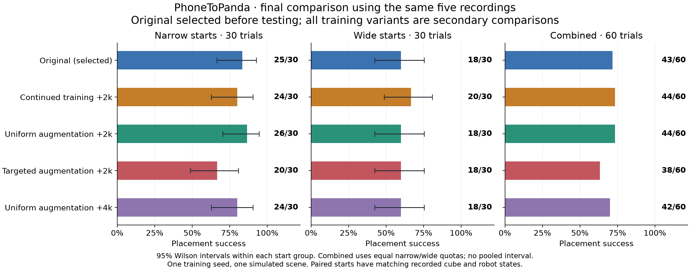

# 11 October 2026: controlled improvement study

**All 300 planned final trials completed. The original checkpoint achieved 43/60 placements and remains the default selected before final testing.** Uniform augmentation and original-data continuation each reached 44/60 in secondary comparisons; the one-placement differences do not establish a reliable improvement from one training seed. Targeted augmentation reached 38/60, and the longer uniform run reached 42/60.

The [4 October experiment](results.md) remains separate: original 15/20 and earlier adaptation 14/20 on seeds 3000–3019. The new study uses the same five human recordings and adds controls, failure analysis and a reserved final test. No IMU data were collected or used.

## Final comparison

Every model used the same 30 narrow and 30 wide starts. Initial cube and observed robot states matched exactly across models. Placement and lift counts were identical in all five final runs; every failed final trial ended without reaching the lift threshold.

| Candidate | Narrow placements | Wide placements | Total placements | Paired improved / regressed vs original |
| --- | ---: | ---: | ---: | ---: |
| `original_h5` — selected default | 25/30 | 18/30 | **43/60** | — |
| `continuation2000_h5` | 24/30 | 20/30 | **44/60** | 3 / 2 |
| `uniform2000_h5` | 26/30 | 18/30 | **44/60** | 1 / 0 |
| `targeted2000_h5` | 20/30 | 18/30 | **38/60** | 12 / 17 |
| `uniform4000_h5` — exploratory | 24/30 | 18/30 | **42/60** | 0 / 1 |



Uniform2000 improved only **narrow seed 6128** and regressed no original success. Its one extra placement across 60 starts is a secondary observation, not a reliable gain or a reason to replace the frozen selection; the exact two-sided paired test gives p = 1.0. Continuation also reached 44/60, with two regressions alongside three improvements and a lower narrow count. Targeted augmentation changed many outcomes in both directions and had five fewer placements overall. These comparisons are unadjusted and do not measure training-seed variability. Full counts, per-group Wilson intervals and paired results are in the [final summary](../results/improvement_20261011/final/summary.md) and [JSON](../results/improvement_20261011/final/summary.json).

The [paired seed-6128 video](../media/final_uniform_improved_seed6128.mp4) shows the original and uniform2000 from the same start; its [sidecar](../media/final_uniform_improved_seed6128.json) records source hashes and state matching. The [presentation rule](../results/improvement_20261011/illustration_plan.json), recorded during final evaluation, selects the first improved and first regressed outcome in narrow-then-wide seed order. There is **no regressed video because no regression exists for this pair**; the [selection receipt](../results/improvement_20261011/illustration_selection.json) lists all outcomes. Playback follows simulation time and holds the final frame of a shorter episode; it does not compare inference speed.

All 17 original-policy final failures issued a sustained close command, defined descriptively as at least three consecutive applied gripper values above 0.5 (0.15 s at 20 Hz). Each recorded some gripper–cube contact, but none recorded bilateral or firm finger-pad contact. At the first qualifying close, median end-effector-to-cube XY separation was **31.5 mm** and signed vertical offset was **+26.0 mm**; peak cube heights ranged from 0.9209 to 0.9326 m, below the 0.97 m lift threshold. Six failures later issued sustained open commands. These reference-point distances and sampled contact flags describe symptoms; they do not establish why grasping failed or that changing closure timing would fix it. The [per-seed failure analysis](../results/improvement_20261011/final_original_failure_analysis.json) preserves definitions, command patterns and report/trace hashes.

## Matched development comparison

All three adaptations started from the original 5,000-update checkpoint and ran for 2,000 additional updates. `h5` means five actions executed before observing again.

| Candidate | Narrow placements | Wide placements | Combined placements | Combined lifts |
| --- | ---: | ---: | ---: | ---: |
| `original_h5` | 10/10 | 6/10 | **16/20** | 16/20 |
| `continuation2000_h5` | 9/10 | 6/10 | **15/20** | 16/20 |
| `uniform2000_h5` | 10/10 | 6/10 | **16/20** | 17/20 |
| `targeted2000_h5` | 7/10 | 5/10 | **12/20** | 12/20 |

Initial cube and robot states matched exactly between candidates. Uniform augmentation improved one wide-start placement and regressed another. Its additional lift ended without placement, so increased lifting did not improve task completion. Continuation improved one placement and regressed two; targeted augmentation improved two and regressed six. Development comparisons are exploratory and unadjusted for multiple comparisons. See the [matched development summary](../results/improvement_20261011/matched_development/summary.md) and [all six development candidates](../results/improvement_20261011/development/summary.md).

The original checkpoint's four development failures all occurred before a successful lift. This identifies a grasp/lift bottleneck; it does not by itself establish the precise controller error. “Lifted but not placed” likewise combines possible drops and unsuccessful placements rather than diagnosing one cause.

On the older known-wide diagnostic starts, the original model achieved **5/10** with five actions per observation and **4/10** with one. The one-action variant did not meet the advancement rule and was not evaluated on the new development groups.

## Data, controls and provenance

The sources remain `IMG_2092`, `IMG_2093`, `IMG_2095`, `IMG_2096` and `IMG_2098`. Calibration, annotation and source-video hashes are checked before replay generation. Human object motion supplies carried-path geometry and timing; approach, grasp and release in demonstrations are supplied by the simulator controller. During policy evaluation, SmolVLA supplies XYZ and gripper commands throughout the episode, with separate downward wrist feedback. See the [method](method.md).

| Collection | Original replays | Added replays | Total frames |
| --- | ---: | ---: | ---: |
| Original / continuation | 20 | 0 | 4,471 |
| Uniform | 20 | 20 | 8,946 |
| Targeted | 20 | 20 | 8,881 |

Each augmented arm has four added successes per source clip. Ten candidates per clip were declared, with the first four successful replays selected. All first four succeeded: **20 attempts, 20 selected, 30 unused candidates per arm**. These are controller-assisted demonstration outcomes, not learned-policy scores. The original 20 NPZ/JSON files were copied byte-for-byte; all 40 added state/action sequences are distinct and none duplicates an original.

Uniform sampling covered `x ∈ [−0.06, 0.06] m`, `y ∈ [−0.23, −0.11] m`. Targeted sampling perturbed old failed-start anchors from seeds 3010, 3012, 3013, 3014 and 3015 with Gaussian XY noise of standard deviation **0.008 m**, clipped to the same rectangle. The target box stayed fixed. The [uniform](../configs/improvement_20261011/uniform_selection.json) and [targeted](../configs/improvement_20261011/targeted_selection.json) JSON coordinates are authoritative: the one-off sampling RNG state was not saved. Their explanatory `data_selection_notes.json` was written retrospectively; the coordinate plans themselves were frozen before generation and training.

[`build_selected_dataset.py`](../scripts/build_selected_dataset.py) sets each recorded position with additional start jitter disabled. It preserves attempts, checks immutable plan/configuration/source hashes, rejects modified or incomplete outputs, and exports only selected successes. The saved replay audit verified original-copy hashes, candidate receipts and every exported state/action row. Episode budgets match, but frame budgets do not: targeted has 65 fewer total frames (0.73%). Additional replays remain augmentations of five recordings.

The three matched adaptations used the same parent weights, new optimizers, learning-rate setting **0.00001**, batch size **4**, training seed **42**, action chunk **20**, and **5** actions per observation. Control stayed at 20 Hz with a 600-step horizon. The original-data continuation separates additional-update effects from replay augmentation.

The installed trainer normally replaces checkpoint normalization with new dataset statistics. [`train_with_frozen_stats.py`](../scripts/train_with_frozen_stats.py) prevents that replacement and verifies the original observation/action mean and standard-deviation tensors at load and save. All three completed checkpoints passed exact transform-tensor verification. Dataset statistics remain recorded as dataset metadata.

Actual accelerator mixed precision was **`no`**, despite `training.use_amp: true` being forwarded as `--policy.use_amp=true`; the installed trainer does not consume that flag. The recorded environment was Python 3.12.3, PyTorch 2.7.1+cu128, LeRobot 0.4.3, hf-libero 0.1.4, robosuite 1.4.0, MuJoCo 3.3.7, Transformers 4.57.6 and Accelerate 1.15.0 on an RTX 5060 / CUDA 12.8. Concurrent workloads prevent interpreting wall times as isolated latency benchmarks.

## Exploratory follow-ups

**Uniform extension:** after uniform2000 tied the original, a separate plan specified another 2,000 updates from that checkpoint, using the same 40-episode dataset, a new optimizer, learning-rate setting 0.000005, seed 42 and preserved normalization. The resulting `uniform4000_h5` checkpoint has 4,000 additional updates after the original and achieved **10/10 narrow + 6/10 wide = 16/20** development placements. It did not improve placement count. This extra-budget intervention is separate from the matched 2k comparison.

**Recovery pilot:** three saved original-policy failures, seeds 3010, 3012 and 3013, were replayed through their first 80 actions. A scripted expert then opened/retracted/reapproached, grasped, followed an existing measured carry path and released. Deterministic reset and saved actions reproduced the initial/takeover eight-dimensional observed robot state, cube XYZ and every applied prefix action within 0.000001. This checks recorded observations/actions, not the complete latent MuJoCo state. There was one reset only, with no subsequent object-pose assignment or attachment. Exported training arrays contain only expert actions after takeover, not the failed policy prefix.

The pilot achieved **3/3 expert-assisted recoveries**, meeting its 2/3 feasibility gate. This is not a learned-policy recovery score. After the extension showed no placement gain, a final training experiment was specified: 20 fixed expert-recovery jobs from five old failed starts and four takeover times (60, 80, 100, 120 steps), balanced over the five source clips. These are 20 distinct takeover states from **five correlated failed-policy rollouts**, not 20 independent failures. All **20/20 collection jobs succeeded** without substitutions, and every recorded prefix-reproduction check had zero error. The exported dataset contains **40 episodes / 8,869 frames**: the byte-identical original 20 episodes / 4,471 frames plus 20 expert-recovery segments / 4,398 frames.

Recovery training completed at **17:38 UTC on 11 October 2026**, after 2,000 updates from the original checkpoint at learning-rate setting 0.00001, batch size 4 and seed 42. The saved checkpoint was verified to preserve the original normalization transforms exactly. This final training arm achieved **7/10 narrow + 6/10 wide = 13/20** development placements and did not advance to final testing. Saved-prefix source seeds cannot count as held-out evaluation, and the recovery expert did not run during learned-policy evaluation.

These follow-ups address the observed pre-lift failures more directly than adding IMUs. The present human-video contribution enters the carry phase. A later IMU study should first verify physical sensor calibration and then compare camera-only versus camera-plus-IMU trajectory recovery under controlled occlusion, with a separate measured outcome. It should not be presented as a fix for the current grasp failures without evidence.

## Frozen selection and final-test design

| Role | Seeds | Trials per model | Per-axis start offset |
| --- | --- | ---: | --- |
| Known-wide diagnostic | 3010–3019 | 10 | ±0.06 m |
| New narrow development | 4100–4109 | 10 | ±0.035 m |
| New wide development | 4200–4209 | 10 | ±0.06 m |
| Reserved narrow final test | 6100–6129 | 30 | ±0.035 m |
| Reserved wide final test | 7100–7129 | 30 | ±0.06 m |

Offsets are around `[0, −0.17] m`. Candidate selection used total placements on the 20 new development starts. Ties preferred the original, then continuation2000, uniform2000, targeted2000, uniform4000 and recovery2000. The extra-budget candidates remain explicitly exploratory.

The final-comparison plan specified the original and three matched adaptations, plus **at most one** completed exploratory finalist: whichever of uniform4000 and recovery2000 had more development placements, preferring uniform4000 in a tie. The full budget of **five models × 60 trials = 300 final episodes** was completed. The plan allowed a time-budget reduction only before locking; no model or group was discarded after observing final outcomes.

The lock was frozen at **17:48 UTC on 11 October 2026**. The original, uniform2000 and uniform4000 tied at 16/20 development placements, so the declared tie order selected **`original_h5`**. The exploratory finalist is **`uniform4000_h5`**, with 16/20 versus recovery2000's 13/20. All five declared finalists completed the full 60-trial evaluation. The adaptation contrasts are secondary and cannot change the frozen selection.

Before testing, [`candidate_lock.json`](../results/improvement_20261011/candidate_lock.json) bound model-file hashes, action horizons, the study/configuration/source hashes, selection-sidecar hashes, and the `reference_candidate`, `selected_candidate` and `contrast_roles`. Each final manifest records the lock hash. The promotion rule applied only to a development-selected non-reference candidate and required a higher final total without reducing the narrow count. Because development selected the original, it remains the default regardless of secondary final rankings.

## Reproduction

Follow the [README setup](../README.md#run-it). The recordings are supplied. The original reference checkpoint is now available through the [15 October model release](../checkpoints/README.md); the additional 11 October candidate weights remain local and are excluded from Git. Exact evaluation of those candidates requires their original checkpoint files. A newly trained parent is a new experiment with potentially different results.

Comments and a [code walkthrough](code_walkthrough.md) were added after this study.
The algorithms are unchanged, but comments change file hashes too. The
[evaluated source archive](../results/improvement_20261011/evaluated_source.tar.gz)
preserves the exact source and configurations checked before final testing;
its [manifest](../results/improvement_20261011/evaluated_source_manifest.json)
lists every file. Use that version in a separate working copy for an exact
historical evaluation. The old final lock intentionally rejects modified source.
The summary commands below only read saved evidence and work with the current
source. The archive contains no weights, recordings, simulator assets or installed
dependencies; those still come from the project and local environment.

For optional local interactive inspection of the uniform2000 checkpoint, use the explicit checkpoint path below. This does not change the default or constitute an aggregate benchmark:

```bash
bash demo.sh --config configs/improvement_20261011/uniform.yaml \
  --checkpoint runs/improvement_20261011/train_uniform/checkpoints/002000/pretrained_model \
  --seed 6128 --auto-start
```

The commands below record the original study recipe. For a new adaptation, copy
the relevant YAML to a new configuration file, then set `training.policy_path`
to the same local original checkpoint for each comparison. The saved study YAMLs
contain paths from the original workstation. In the copies, choose fresh robot,
dataset and training output directories, and pass the copied YAMLs and those
directories to the commands. Keep the saved study configurations unchanged.
Build the original dataset, then the two selected collections:

```bash
.venv/bin/python scripts/build_dataset.py --config configs/main.yaml --skip-prepare

.venv/bin/python scripts/build_selected_dataset.py \
  --config configs/improvement_20261011/uniform.yaml \
  --plan configs/improvement_20261011/uniform_selection.json \
  --robot-dir data/robot/improvement_20261011/uniform \
  --dataset-dir data/datasets/improvement_20261011/uniform

.venv/bin/python scripts/build_selected_dataset.py \
  --config configs/improvement_20261011/targeted.yaml \
  --plan configs/improvement_20261011/targeted_selection.json \
  --robot-dir data/robot/improvement_20261011/targeted \
  --dataset-dir data/datasets/improvement_20261011/targeted

bash train.sh --config configs/improvement_20261011/continuation.yaml
bash train.sh --config configs/improvement_20261011/uniform.yaml
bash train.sh --config configs/improvement_20261011/targeted.yaml
```

`--skip-export` and an optional `--max-jobs N` allow bounded collection; repeat unchanged to resume, then use `--export-only`. Configuration hashes must remain unchanged across collection and export.

The uniform extension depends on the completed `train_uniform/checkpoints/002000/pretrained_model` checkpoint and the same exported uniform dataset. Its YAML sets that parent, a fresh optimizer, 2,000 more updates and learning-rate setting 0.000005:

```bash
bash train.sh --config configs/improvement_20261011/uniform_extended.yaml
```

Recovery collection additionally requires the original weights at **`checkpoints/main`**, the original NPZ/JSON episodes at `data/robot/main`, and the measured source trajectories. The directory passed to `--study` must contain the unchanged `study_plan.json`, `recovery_plan.json`, and `development/original_h5/known_wide/` manifest, report and saved traces. The evidence archive supplies those records, but not weights or robot datasets. Recovery validates their hashes against the local original checkpoint and source files, replays the recorded failed prefixes, and exports expert segments only. Extracting the archive into a fresh study directory permits passing that directory with `--study`; the commands below use the recorded study path:

```bash
.venv/bin/python scripts/build_recovery_dataset.py \
  --study runs/improvement_20261011 \
  --config configs/improvement_20261011/recovery.yaml \
  --collection-plan configs/improvement_20261011/recovery_selection.json \
  --robot-dir data/robot/improvement_20261011/recovery \
  --dataset-dir data/datasets/improvement_20261011/recovery \
  --wall-seconds 1200 --skip-export

.venv/bin/python scripts/build_recovery_dataset.py \
  --study runs/improvement_20261011 \
  --config configs/improvement_20261011/recovery.yaml \
  --collection-plan configs/improvement_20261011/recovery_selection.json \
  --robot-dir data/robot/improvement_20261011/recovery \
  --dataset-dir data/datasets/improvement_20261011/recovery \
  --export-only

bash train.sh --config configs/improvement_20261011/recovery.yaml
```

The separate export command requires all 20 fixed recovery jobs to have succeeded. Completed jobs can be resumed unchanged; incomplete attempts or modified inputs are retained and rejected. These commands describe the recorded experiment with its original parent. Fresh retraining uses new output directories, a new study plan and a new development-selected lock; it cannot reuse the old lock or claim the same results merely by following the recipe.

For evidence-only reproduction, no weights or simulator are needed. The verified [51.3 MB archive](../results/improvement_20261011/study_evidence.tar.gz) contains **536 source files**, including unchanged plans/lock/selection sidecars, group manifests/reports, all **140 development and 300 final traces**, and the canonical source videos for the paired illustration, at study-relative paths. The [archive receipt](../results/improvement_20261011/evidence_archive.json) records its size and SHA256; the [file manifest](../results/improvement_20261011/evidence_manifest.json) records each member hash:

```bash
mkdir /tmp/phonetopanda-evidence

tar -xzf results/improvement_20261011/study_evidence.tar.gz \
  -C /tmp/phonetopanda-evidence

.venv/bin/python scripts/summarize_study.py \
  --study /tmp/phonetopanda-evidence --phase development \
  --names original_h5 continuation2000_h5 uniform2000_h5 targeted2000_h5 \
  --groups new_narrow new_wide \
  --output /tmp/phonetopanda-matched2k-summary

.venv/bin/python scripts/summarize_study.py \
  --study /tmp/phonetopanda-evidence --phase final_test \
  --names original_h5 continuation2000_h5 uniform2000_h5 targeted2000_h5 uniform4000_h5 \
  --output /tmp/phonetopanda-final-summary
```

The summarizer validates counts, traces and paired initial states without reopening absolute checkpoint paths. Final regeneration includes every locked candidate with the reference first and all frozen groups. The [final verification](../results/improvement_20261011/final_verification.json) checked all 536 archived file hashes and regenerated all four published summary JSONs byte-for-byte from a fresh extracted directory without model inference. It also checked the paired video sources, frozen source/configuration identities, local checkpoint files, numeric-audit inputs and curated copies. The pre-final suite passed 137 tests. These checks establish evidence consistency, not independent replication or training-seed robustness. The paired-video source MP4s are included; traces alone cannot reconstruct RGB footage.

To rerun policy evaluation rather than summarize evidence, use [`evaluate_candidate.py`](../scripts/evaluate_candidate.py) with a fresh study directory and the local checkpoint. Final runs must match the archived lock. Fresh retraining requires a new lock selected using development evidence before viewing final outcomes; published final seeds are reproduction cases, not unseen evidence for later tuning.

## Limits and implementation note

This is one custom simulation scene, one fixed object/target, five recordings and one training seed. There is no independent recording-session, new-object or real-robot validation, and no official LIBERO benchmark score. The policy learns translation/gripper commands with fixed wrist feedback. A successful replay, lower training loss or selected video is not an aggregate learned-policy result.

A lift requires the cube centre to exceed 0.97 m. Placement additionally requires the existing inside-box, released-contact and low-speed checks. Per-group Wilson 95% intervals describe marginal proportions; paired discordances compare these fixed checkpoints. The equal-quota narrow/wide total has no pooled binomial interval, and neither intervals nor unadjusted paired tests estimate training-seed variability.

An initial training attempt was discarded when an overly strict save guard rejected upstream scalarization of ancillary count/index metadata. The correction permits only identical-valued ancillary scalar representations; normalization transform tensors still require exact shape and value equality. The failed/interrupted jobs were preserved, no checkpoint from them was evaluated, and the matched runs were restarted and verified.
