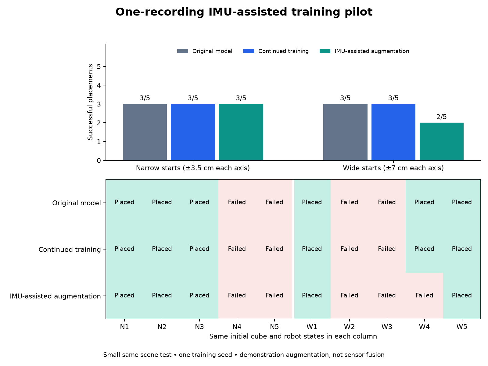

# 15 October 2026: one-recording IMU pilot

**The recording produced four successful simulated Panda demonstrations, but adding them did not improve this small policy test.** The original model and matched continued-training control each placed the cube in **6/10** trials; IMU-assisted augmentation achieved **5/10**. The original checkpoint and the [earlier vision study](improvement_20261011.md) remain the reference.

This experiment asks a narrow question: does adding four robot demonstrations derived from one new IMU recording help more than spending the same extra training budget on the original data? It is not a vision-only versus IMU-only versus fused-tracking comparison.

## What the recording contributes

The source is the reviewed phone video `IMG_2276.MOV` and the right-arm sensor session saved at **5:58:28 PM on 15 October 2026**, `20261015T165828Z_92196435`. The take contains 1,501 valid recorded poses over about 15 seconds. One sensor is on the upper arm and one on the forearm.

The arm estimate uses the recorded orientations and configured segment lengths of 0.30 m and 0.26 m. Its shoulder stays fixed at the origin; +X is forward, +Y is left and +Z is up. The resulting wrist position is an estimate, not a measured hand or object position.

The [manual event labels](../data/experimental/imu_20261015/events.json) place grasp at video time **1.1 s** and release at **10.1 s**, each with an estimated uncertainty of 0.25 s. The provisional timing relation is:

```text
sensor elapsed time = video elapsed time + 0.54 seconds
```

This offset is an assumption supported by the broad movement sequence and file times, with a provisional uncertainty of 0.5 s. There is no shared clock or explicit synchronization gesture. Camera–IMU extrinsics were not calibrated, and absolute tracking accuracy was not measured.

The [side-by-side preview](../media/imu_pilot/paired_video_imu.mp4) shows the phone footage beside the recorded arm estimate at normal speed. Its [report](../media/imu_pilot/paired_video_imu.json) records source hashes and the timestamp used for every preview frame. The preview includes 14.4 seconds of overlapping data, with no pose interpolation or gap filling; its labels retain the timing and fixed-shoulder limitations.

The public files also include the [phone recording](../media/imu_pilot/phone_recording.mp4) and [selected sensor capture](../data/experimental/imu_20261015/sensor_session.json). The phone recording is a sanitized public copy. Its file hash differs from the private original used in the experiment; the [publication record](../media/imu_pilot/publication.json) maps the original sources to the public files. The frozen trajectory and experiment receipts keep their original source hashes rather than treating the public copy as a byte-identical input.

## From human movement to robot demonstrations

The [converter](../phone_to_panda/imu_pilot.py) checks the selected sensor recording, calibration, sample gaps and event times, then writes the [estimated wrist trajectory](../data/experimental/imu_20261015/trajectory.json). The [simulator](../phone_to_panda/simulation.py) uses it as follows:

| Part | Source and role |
| --- | --- |
| Approach, grasp and release | Scripted controller using simulator object and target positions. |
| Carry path | Recorded IMU wrist-path shape between the manually labelled events, aligned and scaled to robot endpoints, with configured height limits. |
| Robot training labels | Actual actions applied by the controller, paired with simulator camera images and robot state. |
| Learned-policy evaluation | Policy actions from simulator cameras and robot state; no live IMU input and no grasping expert. |

The camera supplies event labels for demonstration preparation. It does not correct IMU position or orientation. This is **IMU-assisted demonstration generation**, not a sensor-fusion tracker or a policy that reads IMUs at runtime.

All four planned contact-physics replays passed the simulator's lift-and-place check, at seeds 81000–81003. These are **four simulated starts using one human recording**, not four independent human recordings or physical-robot trials. Their [replay receipts](../results/imu_pilot_20261015/replays.json) are retained.

The [dataset builder](../scripts/build_imu_pilot.py) keeps the original 20 robot episodes and adds those four successful episodes. The exported collection contains **24 episodes / 5,657 frames**: 20 episodes from the original five phone recordings, plus four from this one paired recording. The [dataset summary](../results/imu_pilot_20261015/dataset_summary.json) and [input hashes](../results/imu_pilot_20261015/dataset_inputs.json) record the composition. The original dataset is separate and unchanged.

## Training and measured evaluation

Both training arms start from the same original checkpoint and use **500 additional updates**, batch size 4, seed 42 and learning rate 0.00001. The checkpoint's observation/action normalization is preserved by [the training wrapper](../scripts/train_with_frozen_stats.py). Both use `n_action_steps: 5`: five actions are executed before the next policy observation.

| Candidate | Training data | Extra updates | Narrow placements | Wide placements |
| --- | --- | ---: | --- | --- |
| Original reference | Original 20 episodes | 0 | 3/5 | 3/5 |
| Continued training | Original 20 episodes | 500 | 3/5 | 3/5 |
| IMU-augmented | Original 20 + four IMU-assisted episodes | 500 | 3/5 | 2/5 |

The [fixed plan](../results/imu_pilot_20261015/plan.json) specified five narrow starts at ±0.035 m and five wide starts at ±0.07 m on each horizontal axis, per model. All three models used the same seeds and verified identical initial cube and robot states: 84000–84004 for narrow and 85000–85004 for wide. These are new simulator starts in the same scene, not held-out people, human recordings or environments. All 30 trials are reported; no model was selected using these starts.

Both training runs completed 500 updates, and their saved normalization was reloaded and checked against the original checkpoint ([training receipt](../results/imu_pilot_20261015/training.json)). The [complete comparison](../results/imu_pilot_20261015/README.md) retains every outcome, video and action trace. The [interactive replay page](../results/imu_pilot_20261015/index.html) lets you inspect all ten matched starts.



The augmented model fixed no failed starts and lost one previously successful wide-start placement, at seed 85003. Every failed trial stopped short of a successful lift, with no recorded firm two-finger grasp. This is consistent with a pickup problem that additional carry-path demonstrations did not solve in this run; it is not a causal diagnosis or evidence that IMUs generally make performance worse. Successful controller replays establish usable training demonstrations, not a better learned policy.

The original model remains the default. The useful outcome is a working, traceable route from a real arm recording to additional robot demonstrations, plus an honestly negative training comparison. **197 automated tests passed; two optional physics tests were skipped.** The four demonstration replays and all 30 policy trials separately ran in MuJoCo contact physics.

## Inspect the saved results

The published reports, action traces and videos support inspection of every planned trial and regeneration of the comparison. After installing the [project environment](../README.md#run-it), run these commands from the repository root:

```bash
.venv/bin/python scripts/summarize_imu_pilot.py
.venv/bin/python -m http.server 8768 --bind 127.0.0.1 \
  --directory results/imu_pilot_20261015
```

Open `http://127.0.0.1:8768/`. The page plays saved policy evaluations. The summarizer reads the retained reports and traces, checks their identity hashes and paired initial states, and rebuilds the comparison; it does not load model weights, run a simulator or use a GPU.

Per-model summaries are under `results/imu_pilot_20261015/evaluation/<model>/summary.json`. Each model's `narrow/evaluation/` and `wide/evaluation/` folders contain the reports, videos and traces. The absolute checkpoint paths recorded in these files identify the historical run; inspecting its saved results does not require those paths to exist on another computer.

## Try the saved models

The [checkpoint guide](../checkpoints/README.md) includes verified release downloads.
After project setup, run these from the repository root, closing each simulator
before opening the next:

```bash
python3 scripts/download_checkpoint.py --model original
bash demo.sh --checkpoint checkpoints/pilot_20261015/original

python3 scripts/download_checkpoint.py --model continuation
bash demo.sh --checkpoint checkpoints/pilot_20261015/continuation

python3 scripts/download_checkpoint.py --model augmented
bash demo.sh --checkpoint checkpoints/pilot_20261015/augmented
```

All three use the same main simulation settings and five actions per policy
observation. The download folders are separate from the historical experiment
paths, so inspecting a model does not overwrite an experiment.

## Historical experiment commands

The commands below document the 15 October experiment. They are exact-run drivers for its original file layout, not a portable rerun recipe for a fresh checkout. They require the private original `IMG_2276.MOV` matching the recorded hash, the original sensor capture, the original 20 robot episodes, and the original trained checkpoint. The public phone copy is suitable for inspection but cannot satisfy the private original's file hash. Exact trained weights are available separately in the [model release](../checkpoints/README.md); they are not stored in Git history. Downloading weights does not supply the private original video or regenerate the original training episodes.

The saved [replay](../configs/imu_pilot_20261015/replay.yaml), [continuation](../configs/imu_pilot_20261015/continuation.yaml) and [augmented](../configs/imu_pilot_20261015/augmented.yaml) configurations retain the original workstation paths. The dated builder and evaluator also fix their study, replay, configuration and checkpoint locations in code. Merely copying a YAML and changing its output directory does not redirect the complete experiment. A new run needs its own plan, configuration, output locations and appropriately adapted drivers; the published evidence must remain intact.

The original trajectory was prepared with the converter below. Select the original input path explicitly; the destination must not already exist. This command records preparation history and should not be run over the published trajectory.

```bash
read -r -p "Path to the private original IMG_2276.MOV: " pilot_video
.venv/bin/python -m phone_to_panda.imu_pilot \
  --video "$pilot_video" \
  --session arm_checker/sessions/20261015T165828Z_92196435.json \
  --events data/experimental/imu_20261015/events.json \
  --output data/experimental/imu_20261015/trajectory.json
```

The recorded collection and training commands were:

```bash
.venv/bin/python scripts/build_imu_pilot.py \
  --config configs/imu_pilot_20261015/replay.yaml \
  --trajectory data/experimental/imu_20261015/trajectory.json

bash train.sh --config configs/imu_pilot_20261015/continuation.yaml
bash train.sh --config configs/imu_pilot_20261015/augmented.yaml
```

After training completed, the [pilot evaluator](../scripts/evaluate_imu_pilot.py) ran both planned start ranges for each model:

```bash
.venv/bin/python scripts/evaluate_imu_pilot.py --model original
.venv/bin/python scripts/evaluate_imu_pilot.py --model continuation
.venv/bin/python scripts/evaluate_imu_pilot.py --model augmented
```

The evaluator reuses a completed group only when its original model, configuration, source and output hashes match. It retains and refuses incomplete or changed groups. This protects the existing evidence; it does not make a changed setup equivalent to the original experiment. Original recordings, the original 20 robot demonstrations and the original checkpoint were preserved ([data check](../results/imu_pilot_20261015/data_integrity.json), [checkpoint check](../results/imu_pilot_20261015/original_checkpoint_integrity.json)).

## Limits

There is only one new human recording, one training seed and ten planned evaluation starts per model. The four replays are correlated, so the numerical differences are exploratory. The person's shoulder is outside the video frame, so shoulder motion cannot be checked properly from this clip. Orientation drift, mounting error, estimated limb lengths and the fixed-shoulder assumption can all affect the reconstructed wrist path. The provisional timing also affects which part of that path becomes the carry segment.

The pilot produced usable simulated demonstrations but did not improve this small learned-policy comparison. It did not establish calibrated tracking accuracy, superiority of IMUs over vision, robustness to occlusion, or performance on a physical robot.

## What I would try next

I would first investigate the failed pickups. The failures happened before a successful lift, while the IMU path mainly changed the carry segment. I would check approach position, gripper timing and contact in the saved traces before adding more demonstrations.

For another capture, I would improve sensor mounting, measure segment lengths, repeat the calibration checks and record a clear timing cue visible in both video and IMU motion. I would then collect more varied paired takes, including different starting positions, and compare equal training budgets while reserving separate takes for evaluation. Better mounting, calibration and synchronization may make the demonstrations more consistent, but that benefit has not been measured here. Higher-specification IMUs alone would not guarantee better grasping or task success.
