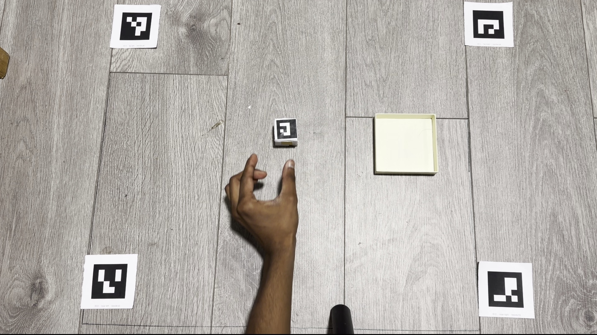

# Recording and calibration

The current dataset comes from five personal phone recordings of an object being
picked up, carried and placed in a box. The public video copies are in
`data/raw/`; the grasp and release labels are in `data/annotations/`.

GPS metadata, unused audio and device metadata streams were removed before
publishing. The video was not re-encoded: all 2,106 frames, their timing and the
measured paths were verified unchanged. Original captures are kept privately.
[The data check](../results/publication_data_check.json) records both original
and public file hashes.

Example frame from the recording setup. The four larger markers define the floor
plane; the smaller marker moves with the object. The open box is the placement
target.

## Physical setup

The phone stayed fixed during each recording. Four reference markers lay flat
around the work area, with IDs 0, 1, 2 and 3. Their black squares measured **50 mm**
on each side. A **30 mm** black-square marker with ID 1 was attached to the object.
These measurements exclude the white paper borders.

The printable images are in [`assets/calibration/`](../assets/calibration/):
`table_marker_0.png` through `table_marker_3.png`, plus `object_marker_1.png`.
Check their printed black-square sizes with a ruler; image size alone does not
guarantee the printer's scale.

Both a reference marker and the object use ID 1. The tracker separates them using
the fixed corner regions in `configs/main.yaml`; it does not mistake the visible
reference for the object when the object is hidden. The four references are fitted
to one plane, with marker 0 as the origin. Their spacing is estimated from the
images rather than assumed to form a perfect rectangle.

The accepted calibration came from `IMG_2090.MOV`, using **25 mm chessboard
squares**. It contains 24 distinct views and has an overall reprojection RMS of
**0.6634 pixels**. It was reused because the camera lens, zoom, focus and recording
resolution were unchanged. The saved parameters are in
[`data/calibration/camera.json`](../data/calibration/camera.json). The raw
calibration video is kept locally; rebuilding this dataset uses the saved file.

## Accepted recordings

Tracking runs at 30 samples per second. At least 90% of samples in the annotated
action window must be measured, and interpolation is limited to gaps of at most
0.2 seconds.

| Recording | Measured samples | Measured fraction | Outcome |
| --- | ---: | ---: | --- |
| IMG_2092 | 251/252 | 99.60% | Accepted |
| IMG_2093 | 311/313 | 99.36% | Accepted |
| IMG_2095 | 297/298 | 99.66% | Accepted |
| IMG_2096 | 346/346 | 100% | Accepted |
| IMG_2098 | 285/298 | 95.64% | Accepted |
| IMG_2097 | 273/304 | 89.80% | Excluded |

The threshold was kept at 90%, so `IMG_2097` was excluded even though it was close.
The accepted clips have four-marker plane-fit RMS errors of about 0.93–0.95 pixels.
Their tracking reports distinguish measured samples from short interpolated gaps.

Grasp and release times were estimated by looking at video frames. They have
roughly 0.2–0.25 seconds of uncertainty and are not contact-sensor measurements.

## If adding recordings later

Keep the phone still and the markers visible. Use matte prints, avoid glare and
hold the object at its sides so its top marker stays visible. Leave a short rest
before pickup and after placement. Measure the printed black squares with a ruler.

Recalibrate if the camera settings change. If the marker layout changes, update
the corner regions before processing. Inspect tracking quality and a successful
physics replay before adding a clip to training. Keep new recordings and results
separate so the existing experiment can still be reproduced.

The supplied five recordings are sufficient to rebuild the current experiment;
collecting another batch is optional.
