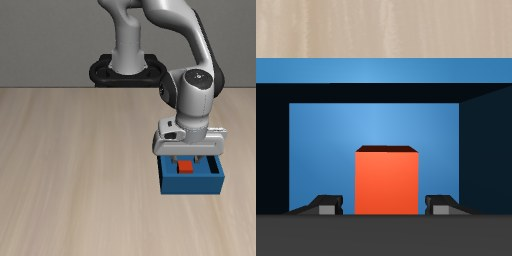
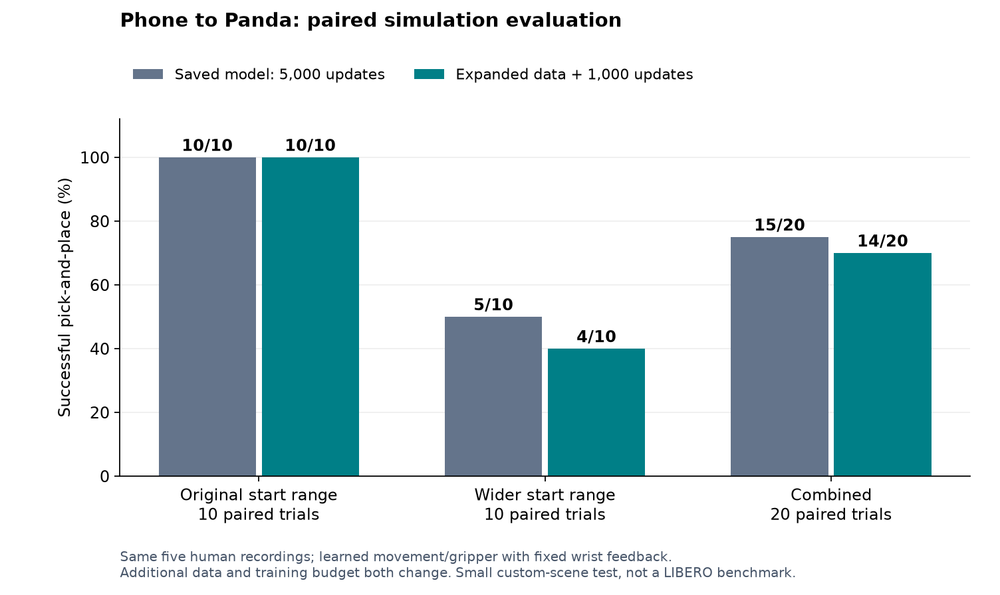

# Results

For the later controlled study, see the [11 October report](improvement_20261011.md).
The counts below are retained as the separate historical experiment.

These experiments finished on **4 October 2026**. All policy scores below use the
same hybrid control: SmolVLA supplies XYZ movement and gripper commands while
feedback keeps the wrist downward. The policy tests do not use scripted
translation, grasp or release.

## Original model

The original dataset contains 20 successful physical replays and 4,471 frames,
derived from five accepted phone recordings. SmolVLA was fine-tuned for 5,000
updates with batch size four. The action chunk length was 20, with five actions
executed before observing again.

The first evaluation used five new simulator starts, seeds 1000–1004:

| Result | Seeds |
| --- | --- |
| Successful placement | 1000, 1001, 1002 |
| Failed to lift before the 600-step limit | 1003, 1004 |

This gives **3/5 placements**. The separate failed development trial at update
2,500 is not part of this final-checkpoint count. Repeating seed 1000 in a viewer
also does not add another test trial. Details are in
[`initial_eval.json`](../results/initial_eval.json).



Example from a successful policy run, shown from the front camera on the left
and the wrist camera on the right. This image is not an additional evaluation
trial; the reported success counts come from the saved trial results.

## Additional training experiment

The next experiment kept the same five phone recordings and generated 40 extra
replays at more varied cube starts. All 40 passed. The combined dataset therefore
contains **60 demonstrations and 13,470 frames**, still from five human recordings.

Training started from the original model weights and ran for another 1,000
updates at learning rate 0.00002, with batch size four. It used a new optimizer
and recomputed normalization statistics for the expanded dataset.

Both models were then tested on the same 20 new starts. Ten used the original
range of up to ±0.035 m on each table axis; ten used a wider range of up to
±0.06 m. These test seeds were separate from the demonstration seeds.

| Test group | Seeds | Original model | Adapted model |
| --- | --- | ---: | ---: |
| Original start range | 3000–3009 | 10/10 | 10/10 |
| Wider start range | 3010–3019 | 5/10 | 4/10 |
| Combined | 3000–3019 | **15/20** | **14/20** |



All paired trials had matching initial cube and robot states. The only changed
success outcome was seed 3011: the original model placed the cube, while the
adapted model failed to lift it. All failures in the wider group stayed below the
required lift height.

The extra training did not improve this sample, so the original checkpoint remains
the default. Twenty trials per model are too few to establish a general difference
from a one-trial change. The experiment also changed both the data and the training
budget, so it does not isolate the effect of adding demonstrations.

The saved reports contain every trial in the paired comparison:

- [Original model, original range](../results/baseline_original_range.json)
- [Original model, wider range](../results/baseline_wider_range.json)
- [Adapted model, original range](../results/adapted_original_range.json)
- [Adapted model, wider range](../results/adapted_wider_range.json)

## Reading these results

The initial 3/5 and later 15/20 results are separate tests of the same original
model. They use different starts and should be reported separately. The 20/20
original replays and 40/40 added replays were controller-assisted data generation,
not learned-policy evaluation.

The tests cover one custom simulation scene, a fixed object and a fixed target.
They show that the learned policy can complete this task at some unseen starts,
with grasping failures becoming more common in the wider range. They do not show
reliable generalization, an official LIBERO benchmark score or real-world transfer.

The formal evaluations saved JSON results and traces; no videos were recorded for
those runs.

## Repeating the comparison

First build and train the main dataset using the README commands. Then build the
expanded dataset:

```bash
.venv/bin/python scripts/build_dataset.py --config configs/expanded.yaml
```

In `configs/expanded.yaml`, set `training.policy_path` to the main checkpoint you
want to extend. For a fresh training run, that is
`runs/train/checkpoints/last/pretrained_model`. The supplied configuration points
to `checkpoints/main`, which is available in the local working copy.

```bash
bash train.sh --config configs/expanded.yaml
.venv/bin/python scripts/compare_models.py \
  --main-checkpoint runs/train/checkpoints/last/pretrained_model \
  --expanded-checkpoint runs/expanded/checkpoints/last/pretrained_model
```

The comparison writes to `runs/evaluation_compare` and keeps failed trials.
Its default seeds reproduce the saved comparison; they are no longer an unseen
test. To test a later change, choose new, disjoint `--narrow-seed` and `--wide-seed`
ranges and a new `--output` folder. A new training run may produce different scores.
