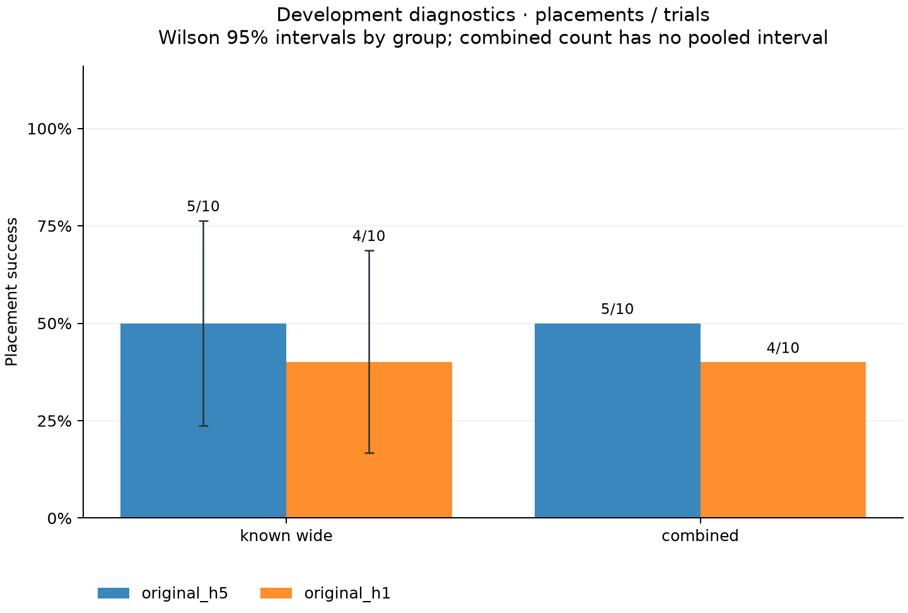
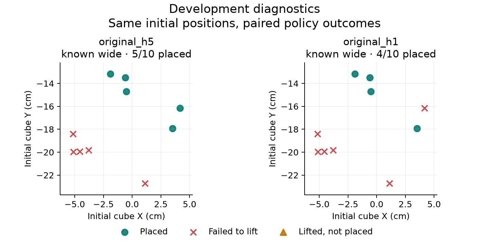

# Development diagnostics

Reference: **original_h5**. Five source recordings; one custom simulated task.

| Model | Group | Placements | 95% Wilson interval | Lifts | Failed to lift | Lifted, not placed |
| --- | --- | ---: | --- | ---: | ---: | ---: |
| original_h5 | known_wide | 5/10 | 23.7%–76.3% | 5/10 | 5 | 0 |
| original_h5 | combined | 5/10 | Not pooled | 5/10 | 5 | 0 |
| original_h1 | known_wide | 4/10 | 16.8%–68.7% | 4/10 | 6 | 0 |
| original_h1 | combined | 4/10 | Not pooled | 4/10 | 6 | 0 |

All compared starts have exactly matching initial cube and robot states.

| Candidate vs reference | Group | Improved | Regressed | Both placed | Both failed | Exact paired p |
| --- | --- | ---: | ---: | ---: | ---: | ---: |
| original_h1 | known_wide | 0 | 1 | 4 | 5 | 1 |
| original_h1 | combined | 0 | 1 | 4 | 5 | 1 |

Exact p values use a two-sided McNemar/binomial test of discordant placements; no multiple-comparison adjustment is applied.

- Development results are diagnostics and selection evidence, not a held-out final test.
- One custom simulation scene, five source recordings, fixed cube and target; no new human recordings or real-robot evidence.
- Hybrid control: learned XYZ/gripper with fixed downward wrist feedback.
- Lift means cube centre exceeded 0.97 m. Failed after lift combines dropped-object and unsuccessful-placement outcomes; it does not diagnose which occurred.
- Wilson intervals describe each start group's marginal binomial proportion; they are not confidence intervals on the paired difference.
- Combined rates use fixed per-group trial quotas (known_wide: 100.0%). No pooled binomial interval is reported for this fixed stratified design.
- Intervals and exact paired p values compare these fixed checkpoints over simulator starts. One training seed provides no estimate of optimizer-seed or training-run variability.
- Development comparisons used for candidate selection are exploratory. Final candidate identities must be locked before final outcomes are observed; final outcomes must not select a new winner.
- Repeated starts in this scene do not establish broad task generalization. A selected rollout video illustrates one seed; aggregate counts provide the performance comparison.
- Recorded wall times may include concurrent workloads and are not a latency benchmark.
