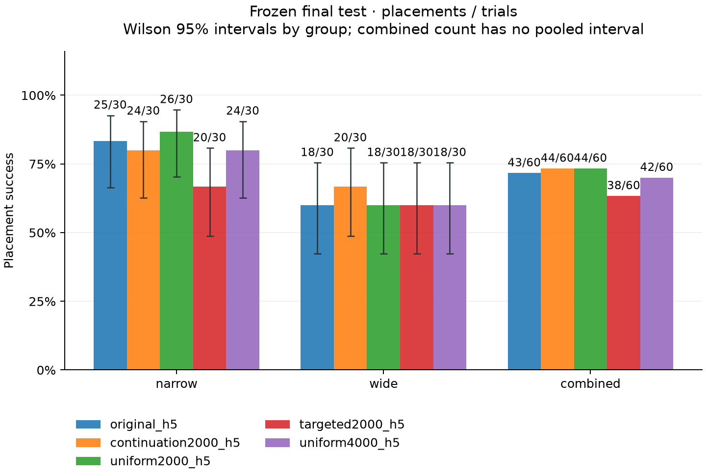
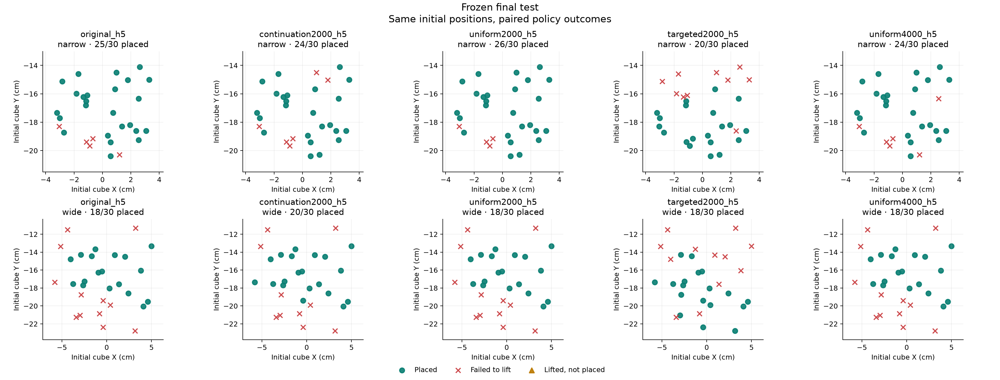

# Frozen final test

Reference: **original_h5**. Five source recordings; one custom simulated task.

Selected before final testing: **original_h5**. This selection is unchanged by final outcomes.

| Locked candidate | Comparison role |
| --- | --- |
| continuation2000_h5 | Secondary matched-update control on the original20 demonstrations. |
| uniform2000_h5 | Secondary matched2k uniform replay-augmentation contrast. |
| targeted2000_h5 | Secondary matched2k failure-targeted replay-augmentation contrast. |
| uniform4000_h5 | Secondary exploratory longer uniform-training contrast; differs in update budget from matched2k arms. |

| Model | Group | Placements | 95% Wilson interval | Lifts | Failed to lift | Lifted, not placed |
| --- | --- | ---: | --- | ---: | ---: | ---: |
| original_h5 | narrow | 25/30 | 66.4%–92.7% | 25/30 | 5 | 0 |
| original_h5 | wide | 18/30 | 42.3%–75.4% | 18/30 | 12 | 0 |
| original_h5 | combined | 43/60 | Not pooled | 43/60 | 17 | 0 |
| continuation2000_h5 | narrow | 24/30 | 62.7%–90.5% | 24/30 | 6 | 0 |
| continuation2000_h5 | wide | 20/30 | 48.8%–80.8% | 20/30 | 10 | 0 |
| continuation2000_h5 | combined | 44/60 | Not pooled | 44/60 | 16 | 0 |
| uniform2000_h5 | narrow | 26/30 | 70.3%–94.7% | 26/30 | 4 | 0 |
| uniform2000_h5 | wide | 18/30 | 42.3%–75.4% | 18/30 | 12 | 0 |
| uniform2000_h5 | combined | 44/60 | Not pooled | 44/60 | 16 | 0 |
| targeted2000_h5 | narrow | 20/30 | 48.8%–80.8% | 20/30 | 10 | 0 |
| targeted2000_h5 | wide | 18/30 | 42.3%–75.4% | 18/30 | 12 | 0 |
| targeted2000_h5 | combined | 38/60 | Not pooled | 38/60 | 22 | 0 |
| uniform4000_h5 | narrow | 24/30 | 62.7%–90.5% | 24/30 | 6 | 0 |
| uniform4000_h5 | wide | 18/30 | 42.3%–75.4% | 18/30 | 12 | 0 |
| uniform4000_h5 | combined | 42/60 | Not pooled | 42/60 | 18 | 0 |

All compared starts have exactly matching initial cube and robot states.

| Candidate vs reference | Group | Improved | Regressed | Both placed | Both failed | Exact paired p |
| --- | --- | ---: | ---: | ---: | ---: | ---: |
| continuation2000_h5 | narrow | 1 | 2 | 23 | 4 | 1 |
| continuation2000_h5 | wide | 2 | 0 | 18 | 10 | 0.5 |
| continuation2000_h5 | combined | 3 | 2 | 41 | 14 | 1 |
| uniform2000_h5 | narrow | 1 | 0 | 25 | 4 | 1 |
| uniform2000_h5 | wide | 0 | 0 | 18 | 12 | 1 |
| uniform2000_h5 | combined | 1 | 0 | 43 | 16 | 1 |
| targeted2000_h5 | narrow | 5 | 10 | 15 | 0 | 0.3018 |
| targeted2000_h5 | wide | 7 | 7 | 11 | 5 | 1 |
| targeted2000_h5 | combined | 12 | 17 | 26 | 5 | 0.4583 |
| uniform4000_h5 | narrow | 0 | 1 | 24 | 5 | 1 |
| uniform4000_h5 | wide | 0 | 0 | 18 | 12 | 1 |
| uniform4000_h5 | combined | 0 | 1 | 42 | 17 | 1 |

Exact p values use a two-sided McNemar/binomial test of discordant placements; no multiple-comparison adjustment is applied.

- Final results use the frozen seed groups and model/settings identities locked before final testing.
- One custom simulation scene, five source recordings, fixed cube and target; no new human recordings or real-robot evidence.
- Hybrid control: learned XYZ/gripper with fixed downward wrist feedback.
- Lift means cube centre exceeded 0.97 m. Failed after lift combines dropped-object and unsuccessful-placement outcomes; it does not diagnose which occurred.
- Wilson intervals describe each start group's marginal binomial proportion; they are not confidence intervals on the paired difference.
- Combined rates use fixed per-group trial quotas (narrow: 50.0%, wide: 50.0%). No pooled binomial interval is reported for this fixed stratified design.
- Intervals and exact paired p values compare these fixed checkpoints over simulator starts. One training seed provides no estimate of optimizer-seed or training-run variability.
- Development comparisons used for candidate selection are exploratory. Final candidate identities must be locked before final outcomes are observed; final outcomes must not select a new winner.
- Repeated starts in this scene do not establish broad task generalization. A selected rollout video illustrates one seed; aggregate counts provide the performance comparison.
- Recorded wall times may include concurrent workloads and are not a latency benchmark.
